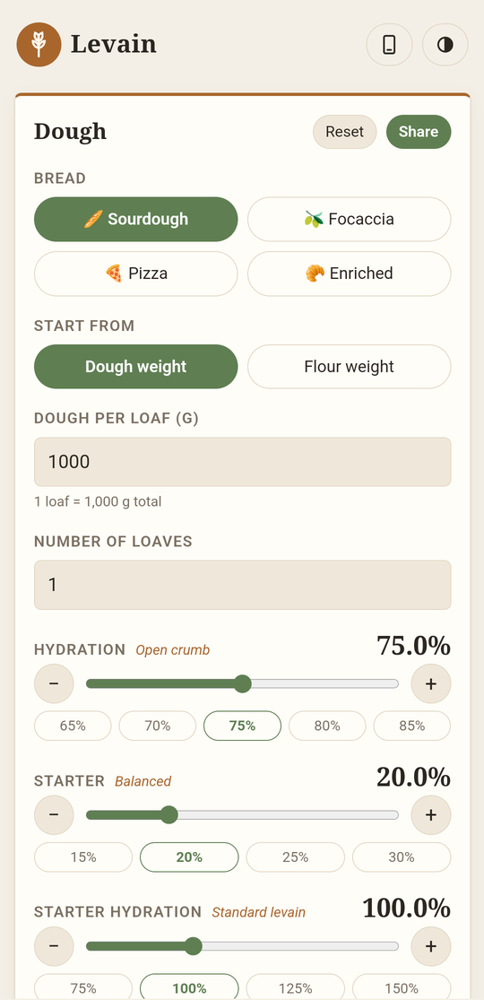
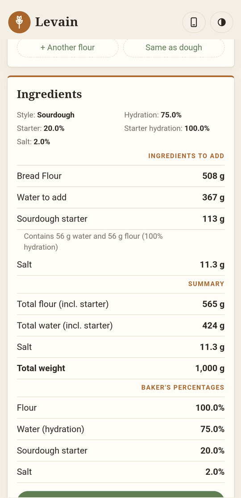
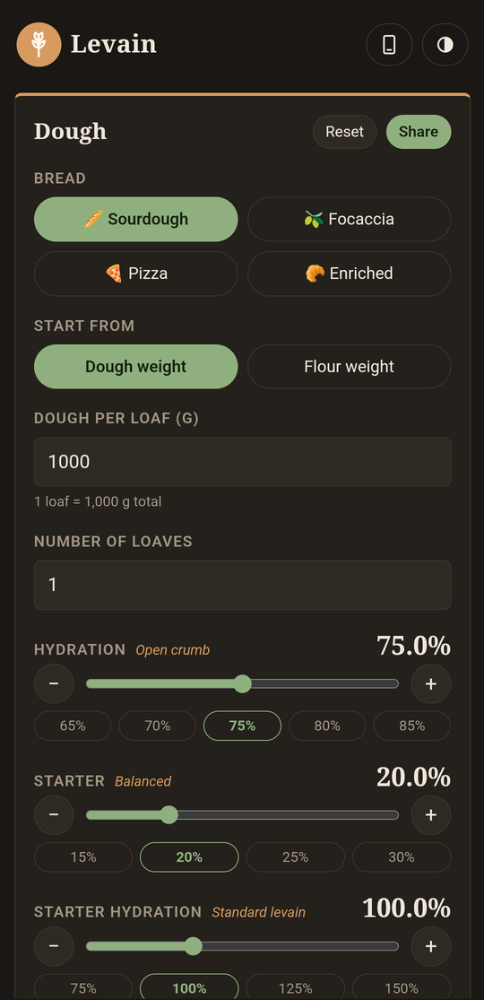

# Levain (Android)

A fully offline bread calculator based on baker's percentages.
No internet permission – everything is bundled in `app/src/main/assets/index.html`.

  
  
  

- Breads: sourdough, focaccia (olive oil), pizza (olive oil), enriched (butter, eggs, sugar)
- Start from dough weight or flour weight, any number of loaves
- Hydration, starter, starter hydration, salt and oil
- Flour blends for the dough and the starter (7 flour types)
- Ingredients to add, totals and baker's percentages
- Notes, method steps (with a template), saved recipes, share as text
- Baking mode with a tick-off list and step timers (uses the phone's clock app)
- Automatic, light or dark theme; keep-screen-on; English and Swedish (follows the phone language)

## Download

**[Download the latest APK](https://github.com/jonsolberg/sourdough-calc/releases/latest/download/Levain.apk)** · [all releases](https://github.com/jonsolberg/sourdough-calc/releases)

## Building
Push to GitHub – the workflow builds the APK and publishes `Levain.apk` on the `apk` branch.
Or open the folder in Android Studio and choose *Build → Build APK(s)*.

## License

Copyright © 2026 Jon Solberg

This program is free software: you can redistribute it and/or modify it under the terms of the
GNU General Public License as published by the Free Software Foundation, either version 3 of the
License, or (at your option) any later version.

This program is distributed in the hope that it will be useful, but WITHOUT ANY WARRANTY; without
even the implied warranty of MERCHANTABILITY or FITNESS FOR A PARTICULAR PURPOSE. See the
[GNU General Public License](LICENSE) for more details.
